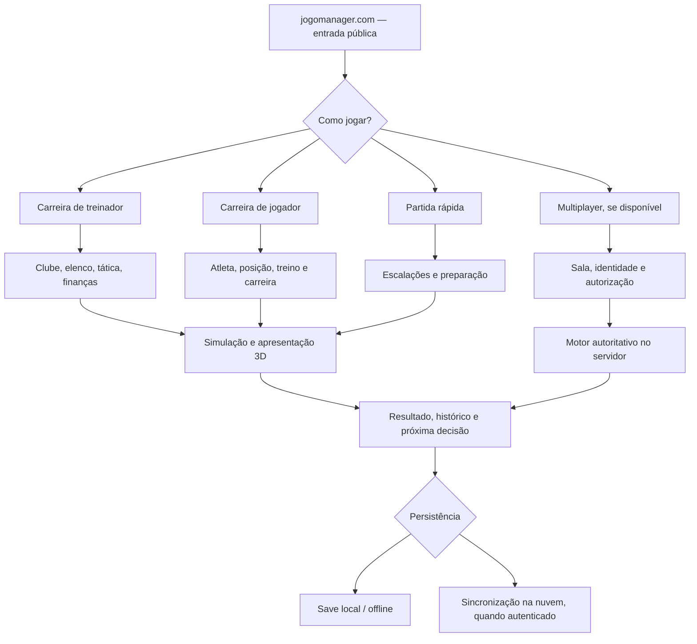
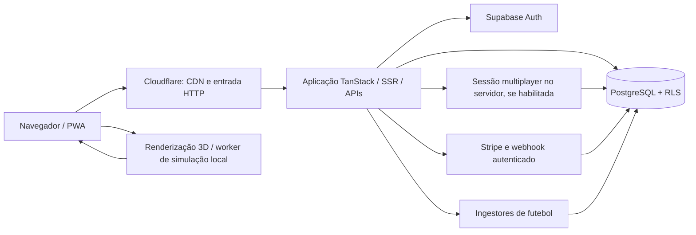
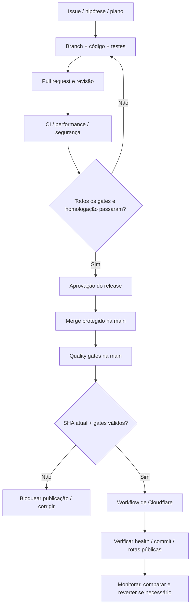
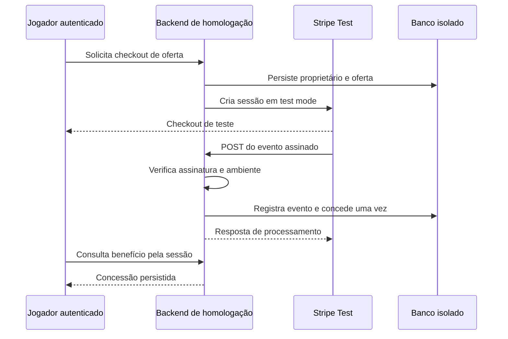

# Pro Football Manager 3D

**Futebol. Decisões. Histórias. Seu clube, sua trajetória.**

[](https://github.com/davizeiro12345678/jogomanager/actions/workflows/quality.yml)
[](https://app.codspeed.io/davizeiro12345678/jogomanager)
[](SECURITY.md)
[](https://jogomanager.com)

**Site oficial e endereço canônico:** https://jogomanager.com

O **Pro Football Manager 3D (jogomanager)** é um jogo brasileiro independente de gestão de futebol para navegador: você escolhe um clube, organiza o elenco, monta estratégias, acompanha a evolução de uma carreira e vê suas decisões se transformarem em partidas com apresentação tridimensional. Também há caminhos próprios para carreira de jogador, partida rápida e experiências online, conforme a versão e a disponibilidade do ambiente.

**[Jogar](https://jogomanager.com)** · **[Começar uma carreira](https://jogomanager.com/carreiras)** · **[Partida rápida](https://jogomanager.com/partida-rapida)** · **[Carreira de jogador](https://jogomanager.com/carreira-jogador)** · **[Guia do jogo](https://jogomanager.com/guias)** · **[Política de segurança](SECURITY.md)**

> **Nota de transparência (21/11/2026):** a presença de uma funcionalidade no código não confirma que ela esteja liberada, homologada ou disponível no domínio público. A branch principal, o PR de integração e o deploy podem estar em revisões diferentes. Os badges mostram o estado reportado pelas respectivas ferramentas, não uma certificação de segurança, FPS ou desempenho físico.

## Navegação deste repositório

1. [O que é possível fazer no jogo](#experiência-do-jogador)
2. [Percurso completo do jogador](#percurso-do-jogador--do-primeiro-acesso-à-partida)
3. [Jornada e evolução do projeto](#evolução-do-projeto--marcos-verificáveis)
4. [Arquitetura e fluxo de dados](#arquitetura-técnica-e-fluxo-de-dados)
5. [Estrutura do código](#mapa-do-repositório)
6. [Desenvolvimento local](#desenvolvimento-local)
7. [Testes, performance e qualidade](#testes-performance-e-critérios-de-aceite)
8. [Entrega e operação](#caminho-de-uma-alteração-até-o-site)
9. [Segurança](#segurança-por-camada)
10. [Estado atual, contribuições e documentação](#estado-de-entrega-e-pendências)
11. [Manual para colaboradores](#manual-para-novos-colaboradores)
12. [Homologação completa](#homologação-de-fluxos-completos)
13. [Operação e recuperação](#operação-observabilidade-e-recuperação)
14. [Plano Cloudflare e Supabase, garantias e certificações](#plano-de-segurança-cloudflare--supabase-e-garantias-do-site)

## Experiência do jogador

| Caminho                      | O que entrega                                                                                                  | Entrada                                                         |
| ---------------------------- | -------------------------------------------------------------------------------------------------------------- | --------------------------------------------------------------- |
| **Carreira de treinador**    | Administração do clube, contratações, elenco, finanças, treino, calendário, táticas e progressão de temporadas | [Carreiras](https://jogomanager.com/carreiras)                  |
| **Carreira de jogador**      | Construção de um atleta, posição, treinos, oportunidades e evolução individual                                 | [Carreira de jogador](https://jogomanager.com/carreira-jogador) |
| **Partida rápida**           | Preparação de um confronto para conhecer o motor, as câmeras e a apresentação 3D                               | [Partida rápida](https://jogomanager.com/partida-rapida)        |
| **Multiplayer**              | Salas, desafio entre treinadores e fluxos autoritativos conforme o ambiente homologado                         | [Multiplayer](https://jogomanager.com/multiplayer)              |
| **Conteúdo e consulta**      | Tabelas, guias, scouting, formações e explicações de regras                                                    | [Guias](https://jogomanager.com/guias)                          |
| **Criação e personalização** | Criação de clube, atleta e ajustes visuais, dentro das opções expostas pela versão                             | [Criador](https://jogomanager.com/criador)                      |

A base do produto é **tomada de decisão**, não controle arcade do atleta. Em partidas, o objetivo é conectar formação, instruções, condição física, comportamento dos jogadores e desfechos simulados. Os dados de clubes e ligas podem ter escopos diferentes entre catálogo informativo, competições publicadas e clubes selecionáveis; não presuma que todo registro importado seja jogável.

### Percurso do jogador — do primeiro acesso à partida



O primeiro acesso pode ocorrer sem conta. O progresso local pertence ao navegador/dispositivo; a sincronização com a nuvem depende de autenticação e disponibilidade do serviço. Antes de trocar de aparelho, limpar dados ou migrar saves, exporte uma cópia e confira a sincronização. A operação offline não significa que login, pagamentos, importação de dados ou multiplayer também funcionem offline.

## Evolução do projeto — marcos verificáveis

Este é o percurso técnico documentado, não uma lista inventada de datas de lançamento. Os marcos refletem arquivos, commits e relatórios presentes no repositório e devem ser interpretados junto ao SHA e ao ambiente de execução.

| Fase/marco                  | Evolução e evidência                                                                                                                   | Observação                                                                                                                                                                                                           |
| --------------------------- | -------------------------------------------------------------------------------------------------------------------------------------- | -------------------------------------------------------------------------------------------------------------------------------------------------------------------------------------------------------------------- |
| **Base do jogo**            | Editor de carreiras, partidas, táticas, calendários e persistência local; módulos em **src/game**, **src/routes** e **src/components** | O histórico do Git registra a evolução detalhada.                                                                                                                                                                    |
| **Motor e apresentação 3D** | Three.js/R3F, física Rapier, workers de simulação, LOD e controle de qualidade gráfica                                                 | Certificação em aparelhos físicos exige medições próprias.                                                                                                                                                           |
| **Outubro de 2026**         | Trabalhos documentados sobre Core Web Vitals, segurança de cache e integrações, SSR/SEO, RLS e distribuição                            | Consultar relatórios de outubro em **docs/**.                                                                                                                                                                        |
| **03/11/2026**              | Estudos de alternativas WASM e pilotos de performance                                                                                  | [Relatório técnico](docs/report-2026-11-03-speed-and-wasm-pilots.md).                                                                                                                                                |
| **06–08/11/2026**           | Evolução de UX de carreira, escritório do técnico, cenas, tutoriais, push/chat e ajustes de CI                                         | Evidências e ressalvas em **docs/report-2026-11-06-\*.md** e **roadmap.md**.                                                                                                                                         |
| **13–14/11/2026**           | Otimizações incrementais de contadores de lesões e fusão do PR #138 para rotas públicas, SSR e indexação                               | Ver [PR #138](https://github.com/davizeiro12345678/jogomanager/pull/138) e notas do [PR #132](https://github.com/davizeiro12345678/jogomanager/pull/132); medições de SQL não equivalem a ganhos de tempo de página. |
| **19–21/11/2026**           | Homologação de migrações, contratos de multiplayer, segurança, desempenho móvel e publicação concentradas no PR #132                   | **Ainda não é release aprovado**. Validar o último SHA, os gates e os ambientes reais antes do merge.                                                                                                                |

O desenvolvimento é independente. [Acesse as ferramentas de criação do jogo](https://jogomanager.com/criador). Ferramentas de assistência, como Lovable, podem participar da edição, mas **GitHub, testes e autorização de release** são as referências para rastrear alterações. O histórico de commits e PRs é a trilha auditável: [commits](https://github.com/davizeiro12345678/jogomanager/commits/main), [pull requests](https://github.com/davizeiro12345678/jogomanager/pulls) e [Actions](https://github.com/davizeiro12345678/jogomanager/actions).

## Arquitetura técnica e fluxo de dados

| Camada                      | Implementação / finalidade                                                                                                           |
| --------------------------- | ------------------------------------------------------------------------------------------------------------------------------------ |
| **UI e roteamento**         | React 19, TypeScript, TanStack Start/Router/Query/Store, Vite, Zod, CSS e design responsivo.                                         |
| **Simulação de futebol**    | Motor TypeScript determinístico, ticks, seeds, contratos de replay e Web Workers; partes auxiliares em Rust/WASM quando comprovadas. |
| **Apresentação de partida** | Three.js, React Three Fiber, Drei, postprocessing, Rapier, BVH, detecção de GPU, LOD e resolução dinâmica.                           |
| **Dados e autenticação**    | Supabase PostgreSQL, RLS, Auth, Realtime e migrações versionadas com Drizzle.                                                        |
| **Infraestrutura e rede**   | Cloudflare/Workers, endpoints SSR e serviços auxiliares; VPS e integrações externas conforme configuração efetiva.                   |
| **Comércio**                | Stripe com separação de sandbox/produção, validação de webhook e concessão durável no servidor.                                      |
| **Catálogo futebolístico**  | Rotinas de ingestão e reconciliação com provedores externos, cotas e validação antes da publicação.                                  |
| **Observabilidade/QA**      | GitHub Actions, Vitest, Lighthouse, CodSpeed, métricas de runtime e relatórios reproduzíveis.                                        |

### Do clique ao resultado: fronteiras de confiança



**Observações de segurança:** o navegador não é autoridade sobre pagamentos, moedas, conquistas persistentes, RLS ou resultado competitivo. Credenciais privilegiadas devem existir apenas em serviços de servidor. Replay local, multiplayer autoritativo e compras têm contratos distintos. Nenhuma tecnologia ou política listada aqui deve ser tratada como efetivamente ativada em produção sem verificação de configuração e tráfego.

### Persistência, simulação e determinismo

- **Save local/PWA:** continuidade no mesmo dispositivo, com cuidados de exportação e sincronização.
- **Save autenticado:** validar posse, progressão e conflitos no servidor; uma cópia local não concede itens ou vitórias.
- **MatchSim:** preservar ordem de cálculos, randomização controlada, snapshots e replays; ganhos de desempenho que mudem o estado da simulação são regressões.
- **3D:** separar evolução visual e física da autoridade de placar, respeitar o orçamento de frame e oferecer fallback para GPUs distintas.
- **Multiplayer:** admitir participantes com ticket, identidade, sala, sequência/ack e autoridade no servidor. Não confundir testes de contrato com uma partida real homologada em vários dispositivos.
- **Catálogo:** normalizar identificadores, evitar duplicação e aplicar cotas/backpressure para não comprometer a API nem o banco.

## Mapa do repositório

| Caminho                      | Responsabilidade                                                                  |
| ---------------------------- | --------------------------------------------------------------------------------- |
| **src/routes/**              | Rotas do site, SSR, APIs, autenticação, modos do jogo e páginas editoriais.       |
| **src/game/**                | Regras, simulação, IA, física, determinismo, testes e benchmarks.                 |
| **src/components/**          | Componentes React, telas, estádios, atletas e apresentação 3D.                    |
| **src/lib/**                 | Bibliotecas de aplicação e lógica compartilhada/servidor.                         |
| **cloudflare/**              | Workers e serviços ligados ao edge.                                               |
| **supabase/** e **drizzle/** | Configuração, migrations, contratos de banco e histórico versionado.              |
| **wasm/**                    | Componentes Rust/WASM e suas validações.                                          |
| **scripts/**                 | Build, segurança, qualidade, performance, verificação de publicação e manutenção. |
| **tests/**                   | Contratos e testes complementares, incluindo SQL.                                 |
| **.github/workflows/**       | Gates de CI, comparação de performance, segurança e publicação.                   |
| **docs/**, **verification/** | Arquitetura, runbooks, planos, auditorias e evidências.                           |

A documentação de arquitetura mais específica está em [docs/architecture/stack-status.md](docs/architecture/stack-status.md) e o contrato de desempenho em [docs/critical-performance.md](docs/critical-performance.md).

## Desenvolvimento local

**Pré-requisitos:** Node.js conforme **.nvmrc** (o pacote exige Node **>=24.22 <25**), npm, Git e, somente para suítes que precisarem, Rust/Cargo e Docker/Supabase CLI. O projeto usa **package-lock.json** para instalação npm reprodutível; a presença de **bun.lock** não autoriza misturar resoluções de dependência na mesma medição.

```bash
git clone https://github.com/davizeiro12345678/jogomanager.git
cd jogomanager
nvm use
npm ci
cp .env.example .env
npm run dev
```

Preencha **.env** apenas com chaves locais ou de staging. **.env.example** lista nomes e valores públicos ilustrativos: não é um conjunto de credenciais para produção. Se um serviço exigir credenciais privadas, use um cofre/secret store do ambiente e o mecanismo de secrets de sua plataforma. Não commit **.env**, tokens, cookies nem dumps de usuários.

```bash
npm run lint
npm exec -- tsc --noEmit --pretty false
npm test
PFM_LOCAL_VERIFY=1 npm run build
npm run test:performance-gates
npm run wasm:test
npm run graphics:build
npm audit --omit=dev --audit-level=high
```

Alguns comandos exigem ferramentas, redes ou dependências opcionais não presentes em uma instalação básica. **Não rotule uma etapa pulada como aprovada**. Para visualizar o estúdio gráfico após gerar os assets:

```bash
npm run graphics:preview
# Abrir http://127.0.0.1:4193/player-studio.html
```

O proxy de prévia deve buscar somente recursos públicos: nunca encaminhe cookies ou cabeçalhos de autorização a um host de assets. O desenvolvimento, a homologação e a produção devem usar bancos, contas, webhooks, domínios e segredos separados.

## Testes, performance e critérios de aceite

A fonte de verdade para os gates é [Quality gates](.github/workflows/quality.yml), junto aos workflows de [CodSpeed](.github/workflows/codspeed.yml), [testes de carreira](.github/workflows/career-regression-tests.yml), [publicação](.github/workflows/cloudflare-production.yml) e segurança.

| Dimensão                | Evidência exigida                                                                                                                       |
| ----------------------- | --------------------------------------------------------------------------------------------------------------------------------------- |
| **Qualidade de código** | Lint sem avisos, typecheck, testes e build.                                                                                             |
| **Simulação**           | Seeds e checkpoints reproduzíveis, replays determinísticos e stress de partidas.                                                        |
| **Performance**         | Comparar base e candidato no mesmo runner, mesmas fixtures, runtime e ordem controlada; registrar p50/p95/p99 e regressões.             |
| **Bundle**              | Comparação do custo de startup e contrato de assets, sem esconder trabalho deslocando código para outro caminho.                        |
| **Gráficos**            | Contratos 3D, medições de frame time/tempo de bloqueio e verificação visual; aparelhos reais são evidência separada.                    |
| **Mobile**              | Lighthouse com amostras múltiplas e critérios do [documento de performance](docs/critical-performance.md), não apenas um score isolado. |
| **Banco e segurança**   | Replay de migrações em banco descartável, RLS e permissões mínimas, contratos de Edge e verificação de dependências.                    |
| **Operação**            | Homologar OAuth, checkout sandbox/webhook idempotente, multiplayer em vários aparelhos, reversão e restauração.                         |

Metas como **89% de melhoria no CodSpeed**, **97+ em todas as rotas** ou **60 FPS** são metas, **não resultados automáticos**. Um teste passando em CI não substitui uma compra Stripe de teste ponta a ponta, uma partida real com múltiplos participantes, a restauração de um backup nem a comparação na mesma configuração de hardware.

## Caminho de uma alteração até o site



O [workflow de publicação](.github/workflows/cloudflare-production.yml) escuta o sucesso de **Quality gates** em um **push** da **main**, confirma a revisão atual e executa a rotina de deploy quando há credenciais. **Mudar a main pode disparar publicação automática:** nunca fazer merge sem considerar impacto operacional. O deploy, o estado do Worker, a propagação de CDN, o DNS e o conteúdo servido são verificações distintas.

Depois de uma publicação autorizada:

```bash
node scripts/verify-public-discovery.mjs --live
```

Verifique **/llms.txt**, **/robots.txt**, **/sitemap.xml**, **/api/health** e o SHA efetivamente servido. Quando houver divergência, investigue o estado do deploy antes de invalidar o cache. Não use purga de CDN como substituto de correção de origem.

## Segurança por camada

1. **Repositório:** PR protegido na main, checks obrigatórios, sem force-push nem exclusão; ações com permissões mínimas, revisão de atualizações e trilha de auditoria.
2. **Dependências/código:** alertas e atualizações automatizadas quando habilitados no GitHub, CodeQL/varreduras de CI, auditoria de lockfiles; resultados devem ser triados.
3. **Navegador e borda:** CSP, headers, proteção contra XSS/CSRF conforme rota, HTTPS, WAF/rate limiting e controle de cache privado na configuração efetiva.
4. **Identidade e dados:** Supabase Auth, validação de sessão, RLS, escopos por usuário, operações privilegiadas exclusivamente no backend e backups restauráveis.
5. **Pagamentos:** isolamento de sandbox/live; confirmação por webhook autenticado, idempotência e concessão validada pelo servidor, não pelo retorno do navegador.
6. **Multiplayer e comunidade:** autoridade de sala, antirreplay, rate limiting, prevenção de abuso, restrição de chat e auditoria com dados mínimos.
7. **Operação e incidentes:** segredos em cofres, rotação quando necessário, monitoramento e capacidade testada de recuperação, sem divulgar topologia sensível.

Consulte [SECURITY.md](SECURITY.md) para escopo de suporte, reporte confidencial, práticas de teste seguro e tratamento de incidentes. **Documentação de controle não comprova sua ativação no painel da Cloudflare, GitHub, Stripe, Supabase ou VPS.** O inventário de proteções confirmadas e pendentes está em [auditoria de segurança do repositório (21/11/2026)](docs/security/repository-protections-2026-11-21.md).

## Estado de entrega e pendências

O [PR #132](https://github.com/davizeiro12345678/jogomanager/pull/132) (integração separada das melhorias documentais deste PR) consolida trabalho de arquitetura, autenticação, performance, multiplayer e segurança, mas **não deve ser considerado publicado** enquanto houver homologações operacionais pendentes. Não antecipar disponibilidade de funcionalidades somente porque existem branches ou testes automatizados aprovados.

Prioridades de homologação antes da liberação: verificação de OAuth real, Stripe em sandbox com webhook, multiplayer 1×1 e 2×2 em dispositivos físicos, conectividade/recuperação de infraestrutura, inventário de riscos e verificação de publicação em domínio canônico. O estado mais recente e a lista de bloqueios devem ser conferidos no PR e nos artefatos do **último SHA**, não em screenshots antigos.

## Manual para novos colaboradores

Este manual complementa [AGENTS.md](AGENTS.md), que contém contratos de implementação obrigatórios. Antes de alterar o projeto, defina **qual ambiente**, **qual camada é autoridade sobre o estado** e **qual evidência prova a mudança**. A documentação pública não concede acesso a sistemas nem a credenciais.

### Onde encontrar cada responsabilidade

| Área                                  | Código de referência                              | Contratos essenciais                                                   |
| ------------------------------------- | ------------------------------------------------- | ---------------------------------------------------------------------- |
| Interface, SSR, acessibilidade e i18n | `src/components/`, `src/routes/`, `src/i18n/`     | Renderização inicial, navegação, foco, tradução e CSS crítico          |
| Carreira e saves                      | `src/game/`, `src/lib/`                           | Integridade do progresso, armazenamento local e autorização na nuvem   |
| IA, motor de partidas e física        | `src/game/`, `wasm/`                              | Seeds, replay determinístico, ordem das operações e perfil de hardware |
| Estádios, atletas e gráficos 3D       | `src/components/game/`                            | Canvas, LOD, GPU, frame time e fallback                                |
| Login, MFA, OAuth e passkeys          | `src/integrations/supabase/`, `src/routes/`       | PKCE, callback, sessão, RLS e origem permitida                         |
| Loja e assinaturas                    | `src/routes/api/`, `src/lib/`                     | Verificação de assinatura, conta Stripe, preço e concessão idempotente |
| Multiplayer                           | `src/game/online/`, `services/`                   | Tickets, salas, estado autoritativo, reconexão e antirreplay           |
| Migrações e ingestão                  | `drizzle/migrations/`, `supabase/`, `cloudflare/` | Histórico canônico, quotas e testes em banco descartável               |
| CI/CD, segurança e operação           | `.github/workflows/`, `scripts/`, `infra/`        | SHA, gates, rollback, health e evidências                              |

### Matriz de configuração: público versus confidencial

| Variável ou família                                                | Papel                                 | Exposição permitida                                          |
| ------------------------------------------------------------------ | ------------------------------------- | ------------------------------------------------------------ |
| `VITE_SUPABASE_URL` e `VITE_SUPABASE_PUBLISHABLE_KEY`              | Cliente e autenticação Supabase       | **Públicas**; devem apontar para o mesmo projeto do ambiente |
| `SUPABASE_URL`                                                     | URL da API acessada pelo servidor     | Identificação de projeto; não é um segredo                   |
| `SUPABASE_SERVICE_ROLE_KEY`                                        | Operações administrativas autorizadas | **Somente servidor**, nunca bundle ou logs                   |
| `PAYMENTS_ENVIRONMENT`                                             | Seleciona `sandbox` ou `live`         | Configuração do deployment; confirmar conta correspondente   |
| `STRIPE_LIVE_API_KEY` e credencial de teste correspondente         | Checkout e consulta Stripe            | **Somente servidor**, com menor privilégio                   |
| `PAYMENTS_LIVE_WEBHOOK_SECRET` e `PAYMENTS_SANDBOX_WEBHOOK_SECRET` | Validação dos webhooks                | **Somente servidor**, diferentes por endpoint                |
| `CLOUDFLARE_API_TOKEN`                                             | Entrega/autorização no Cloudflare     | **Segredo de CI**, nunca disponibilizar no navegador         |
| `PFM_BUILD_SHA` e `EXPECTED_COMMIT_SHA`                            | Identidade da versão implantada       | Identificadores, não senhas                                  |

O Vite incorpora variáveis `VITE_*` ao **bundle do navegador**. Um health check saudável com o backend pode coexistir com um frontend incapaz de iniciar o Auth se faltar a URL/chave pública no build. A chave publicável não dispensa RLS nem autorização por usuário.

**Staging de verdade** exige projeto Supabase e banco próprios, chaves próprias, callbacks OAuth próprios, Stripe exclusivamente de testes, endpoint e segredo de webhook próprios e serviço multiplayer sem acesso à base produtiva. Um subdomínio de staging que utiliza service role de produção **não está isolado**.

### Primeiros comandos e verificações

```bash
node --version
npm ci
npm run lint
npm exec -- tsc --noEmit --pretty false
npm test
npm run test:stress
PFM_LOCAL_VERIFY=1 npm run build
npm run bundle:check
npm run test:performance-gates
```

Use o Node definido por `.nvmrc` e o lockfile correspondente. Os testes e builds de referência não devem modificar a resolução de pacotes. Se o Vite dev falhar ao resolver módulos exclusivos de Cloudflare, teste o **alvo de runtime correto** com build e `npm run preview:worker`, em vez de remover imports do servidor. Relate qualquer ferramenta ou credencial ausente como **não testado**, nunca como aprovado.

## Homologação de fluxos completos

O projeto separa três níveis de prova: **unitário** (funções e mocks), **integração** (serviços isolados e contratos de API) e **E2E** (navegador, provedor real em test mode e persistência). Um nível não substitui os outros.

### OAuth e gerenciamento de sessão

1. Abrir `/auth` em navegador limpo e examinar erros JavaScript, CSP, cookies e URL do projeto Supabase.
2. Confirmar somente os provedores realmente habilitados em `/auth/v1/settings`.
3. Iniciar OAuth com PKCE e verificar que a URL de callback no **provedor externo** corresponde exatamente ao callback do **Supabase**, enquanto `redirectTo` retorna a caminho interno permitido do aplicativo.
4. Autenticar uma **conta própria de homologação** e validar retorno, identidade, renovação, reload, logout, expiração e revogação.
5. Executar com duas contas distintas para rejeitar leitura e escrita cruzadas.
6. Homologar e-mail, recuperação, MFA e passkeys apenas quando configurados; a chegada à página de login do Google/GitHub **não** é login concluído.

Consulte [métodos de Auth](docs/auth-methods.md) e [política de segurança](SECURITY.md).

### Stripe: checkout → webhook → benefício



Verifique assinatura inválida, pagamento pendente, falha assíncrona, pagamento pago, replay do mesmo `event_id`, retry após falha de banco, titularidade da sessão, assinatura criada/renovada/cancelada e reconciliação de estornos. Um `GET` ao endpoint de webhook não comprova processamento de eventos; o fluxo financeiro depende do `POST` **assinado** e da persistência. Nunca conceder benefício por redirecionamento do navegador. Consulte [pagamentos](docs/payments-configuration.md).

### Multiplayer 1×1 e 2×2

| Cenário          | Evidência para aprovação                                                                               |
| ---------------- | ------------------------------------------------------------------------------------------------------ |
| **1×1**          | Dois usuários e clientes independentes entram, jogam, encerram e recebem o mesmo placar do servidor    |
| **2×2**          | Quatro usuários ocupam assentos únicos, equipes corretas e tickets vinculados à sala                   |
| **Reconexão**    | Cliente desconectado retoma sessão válida sem ações duplicadas nem perda de estado confirmado          |
| **Antirreplay**  | Ticket expirado, mensagem fora de ordem, operação cruzada entre salas e usuário anônimo são rejeitados |
| **Determinismo** | Replay, checkpoints, hashes, ranking e resultado persistido concordam                                  |
| **Recuperação**  | Falha de transporte e encerramento do Worker deixam estado reconciliável                               |

Health `ready`, tabelas SQL presentes e testes de funções são evidências necessárias, mas **não provam** partidas completas com vários aparelhos.

## Operação, observabilidade e recuperação

### Diagnóstico por sintoma

| Sinal                                                  | Primeira investigação                                             | Armadilha a evitar                            |
| ------------------------------------------------------ | ----------------------------------------------------------------- | --------------------------------------------- |
| `/api/health` retorna **503**                          | Bindings runtime, dependências, deployment e banco                | Concluir sem prova que o banco caiu           |
| Health **200**, `/auth` quebra                         | Bundle Vite, chaves públicas, console, Auth e CSP                 | Declarar OAuth pronto só pelo health          |
| Rotas do domínio principal falham, subdomínio responde | Custom Domain, Load Balancer, regras, DNS e origem                | Alterar nameservers ou registro por tentativa |
| Checkout abre, mas item não chega                      | Ambiente Stripe, webhook, assinatura, idempotência e RLS          | Conceder por `success_url` do navegador       |
| Multiplayer pronto na saúde, jogo indisponível         | Rotas públicas, tickets, transporte, sessões e persistência       | Confundir health com partida homologada       |
| Lighthouse móvel intermitente                          | Pior das três medições, long tasks, LCP/TBT, runner e bundle      | Apagar a primeira amostra ou baixar limites   |
| Frame time anormal                                     | GPU real, temperatura, resolução, qualidade, draw calls e p95/p99 | Tomar benchmark CPU como FPS físico           |

### Canário de release com identidade

A rotina de publicação exige a revisão **efetivamente servida**, não apenas sucesso do comando de deploy:

```bash
# Executar somente depois da aprovação do SHA exato da release.
EXPECTED_COMMIT_SHA="<SHA_DE_40_CARACTERES_APROVADO>" \
  node scripts/verify-public-deployment.mjs

# Diagnóstico sem alterar dados:
curl --fail --silent --show-error https://jogomanager.com/api/health
```

O SHA entre sinais de menor/maior no exemplo é **um marcador a substituir**, não um valor válido. Depois da publicação, conferir login, página inicial, tabelas, CSS, headers, assets e versão em navegadores reais; testar fluxos de escrita **somente** no staging autorizado. Os logs e relatórios devem conter SHA, ambiente, horário, request ID e resultado, sem tokens, cookies ou dados pessoais.

### Procedimento mínimo de rollback

1. Registrar versão aprovada e versão realmente servida; bloquear promoções concorrentes.
2. Reverter para uma versão de Worker anteriormente **testada**, nunca para uma origem legada desconhecida.
3. Não aplicar rollback de banco apagando progresso real ou reexecutando migrações históricas sobrepostas.
4. Conferir DNS/Custom Domain, TLS, rotas, health, SSR, Auth, webhooks e filas depois da mudança.
5. Guardar evidência sanitizada, causa raiz e teste de regressão no PR/issue.

### Comparações de performance sem regressão

| Dimensão             | Protocolo mínimo                                                                                                         |
| -------------------- | ------------------------------------------------------------------------------------------------------------------------ |
| **CodSpeed / CPU**   | Baseline e candidato no mesmo runner, mesmo lockfile, fixtures e amostras; informar variância e regressões por benchmark |
| **MatchSim**         | Mesmas seeds, checkpoints e hashes de replay; ganho de tempo com resultado diferente **não** é otimização aprovada       |
| **Lighthouse móvel** | Cinco rotas, três execuções, agregação pessimista; performance ≥97, LCP ≤2.500 ms e TBT ≤200 ms                          |
| **3D/GPU**           | Mesma resolução, dispositivo, qualidade, temperatura, carga e p95/p99 de frame time                                      |
| **Bundles**          | Comparar bytecode/JS executado e custo de inicialização, além de bytes gzip/Brotli                                       |

O contrato em [docs/critical-performance.md](docs/critical-performance.md) é a referência normativa. Um rerun verde de um teste anteriormente intermitente recupera um check, mas não demonstra que a causa foi removida.

## Plano de segurança Cloudflare + Supabase e garantias do site

O [plano detalhado de segurança e garantias](docs/security/cloudflare-supabase-assurance-2026.md) contém o **inventário verificado em 22/11/2026**, a matriz de controles, os avisos do Supabase, a ordem de correções e os critérios para publicar evidências de conformidade. Ele distingue configuração habilitada, teste técnico, homologação E2E e avaliação por terceira parte.

| Componente | Confirmação técnica | Lacuna relevante |
| --- | --- | --- |
| **Cloudflare** | TLS Full (strict), HTTPS obrigatório, WAF gerenciado, regras personalizadas, rate limiting de Auth, Bot Fight Mode e headers configurados | DNSSEC ainda `pending`; verificar comportamento real e não reativar LB do apex sem origem independente |
| **Supabase** | Auth/Postgres e segurança por RLS disponíveis; ferramenta de advisors consultada | Revisar privilégios de GraphQL e função `SECURITY DEFINER`; validar usuários A/B e staging isolado |
| **Pagamentos** | Stripe integrado em código, contratos para webhook assinado e idempotência | Checkout e entrega real em sandbox ainda exigem prova E2E |
| **Multiplayer** | Estruturas de tickets/partidas e testes automatizados | Partidas reais 1×1 e 2×2, reconexão e ranking ainda exigem prova |
| **Performance** | Orçamentos móveis e CodeSpeed com gates no CI | Pico de primeira carga da home deve ser corrigido, sem mascarar a primeira amostra |
| **Certificação** | Trilha de evidências definida (ASVS, TLS, acessibilidade, PCI conforme escopo, privacidade) | **Não há certificado independente do site declarado ou comprovado neste documento** |

O plano também explica por que **ISO/IEC 27001, SOC 2 e PCI DSS** não podem ser reivindicados apenas por usar fornecedores com certificações próprias. Os badges deste README representam estado de automações ou políticas declaradas, **não** selos emitidos por terceiros.

## Participação, manutenção e uso

- Para reportar erros comuns ou propor mudanças, use [Issues](https://github.com/davizeiro12345678/jogomanager/issues) sem dados pessoais ou segredos.
- Para falhas de segurança, **não abra issue público com prova de exploração**; leia [SECURITY.md](SECURITY.md).
- Faça mudanças em branch, preserve contratos de simulação e operações, acrescente testes e descreva riscos e plano de reversão.
- Revisões de terceiros e automações ajudam, mas não devem impor aprovações impossíveis ao mantenedor único nem liberar o release com gates vermelhos.
- O repositório é público. **Disponibilidade do código não equivale, por si, a uma licença de reutilização:** verifique as permissões aplicáveis antes de redistribuir código, conteúdo ou assets.

### Leituras complementares

[Design](DESIGN.md) · [Arquitetura](docs/architecture/stack-status.md) · [Performance crítica](docs/critical-performance.md) · [Runbook Cloudflare/Supabase](docs/cloudflare-supabase-deployment.md) · [Pagamentos](docs/payments-configuration.md) · [Autenticação](docs/auth-methods.md) · [Plano e progresso do release #132](https://github.com/davizeiro12345678/jogomanager/pull/132) · [Política de segurança](SECURITY.md) · [Site oficial](https://jogomanager.com)

---

**Pro Football Manager 3D / jogomanager.com** — desenvolvido de maneira independente. Acompanhe o progresso no [GitHub](https://github.com/davizeiro12345678/jogomanager) e experimente a versão pública em [jogomanager.com](https://jogomanager.com).
