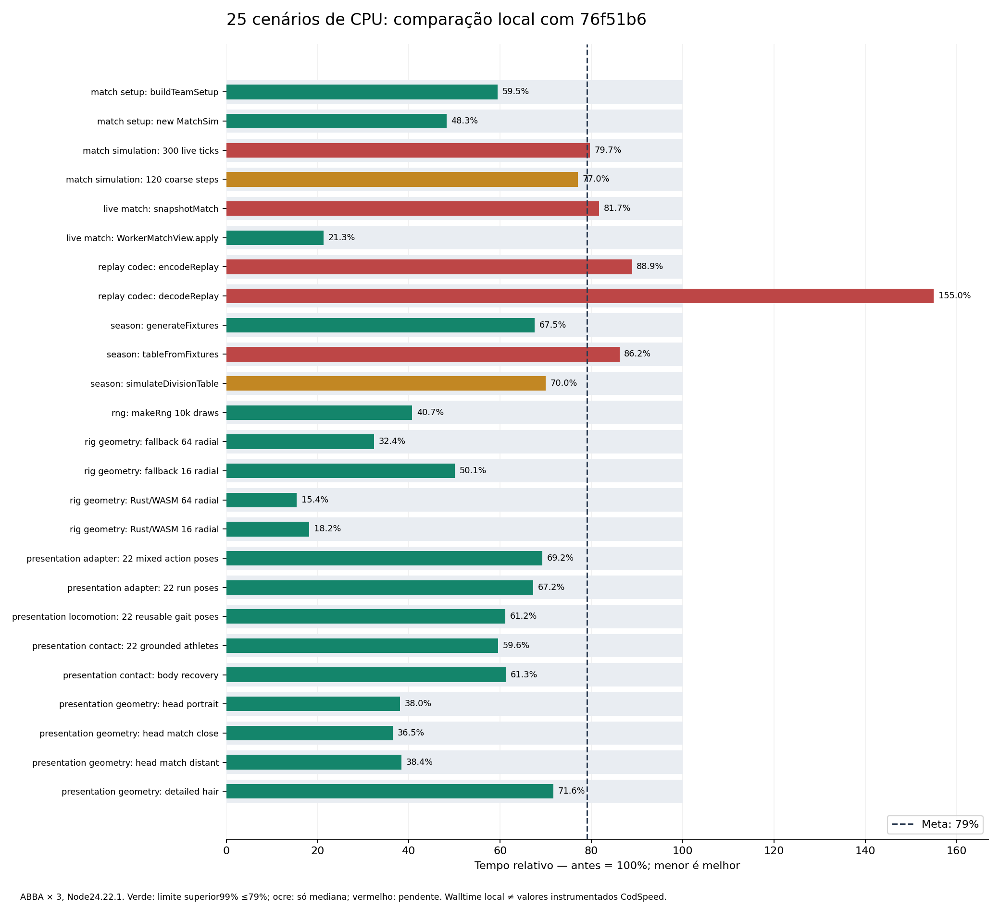

# CPU Match3D: meta de 79% do tempo anterior

> **Histórico de `ccba0f9`.** As medições abaixo pertencem a esse commit. O cálculo plano experimental e o cache do decoder foram retirados depois; esta tabela não certifica o HEAD atual. Veja [a correção guiada pelo CodSpeed](correction-native-integration.md).

**Resultado local: 20/25 medianas atingem a meta; 18/25 também pelo limite superior do intervalo exploratório de 99%.** Meta global ainda não certificada pelo CodSpeed.

A solicitação foi interpretada como tempo novo ≤ 0,79 × tempo anterior: redução mínima de 21%, sem alterar sementes, cargas, número de atletas, detalhamento geométrico, frequência física, critérios ou limites. Base congelada: `76f51b6a784d6f6b4fc0ff5bf06a7e08173cf639`.

## Comparação local dos 25 cenários

Valores em milissegundos por execução do callback original. “Intervalo” é o intervalo da razão depois/antes; menor é melhor. Aprovado abaixo é uma classificação desta medição, sem aprovar release.

| Cenário | Antes ms | Depois ms | Tempo anterior | Intervalo 99% | Meta local |
|---|---:|---:|---:|---:|---|
| match setup: buildTeamSetup | 0.133061 | 0.079130 | 59.47% | 0.505–0.652 | Aprovado no intervalo |
| match setup: new MatchSim | 0.110759 | 0.053454 | 48.26% | 0.450–0.732 | Aprovado no intervalo |
| match simulation: 300 live ticks | 5.541001 | 4.416663 | 79.71% | 0.699–0.867 | Pendente |
| match simulation: 120 coarse steps | 3.781696 | 2.911445 | 76.99% | 0.736–0.962 | Parcial: só mediana |
| live match: snapshotMatch | 0.003557 | 0.002905 | 81.67% | 0.722–0.879 | Pendente |
| live match: WorkerMatchView.apply | 0.026037 | 0.005551 | 21.32% | 0.192–0.229 | Aprovado no intervalo |
| replay codec: encodeReplay | 19.952226 | 17.738054 | 88.90% | 0.584–1.504 | Pendente |
| replay codec: decodeReplay | 8.624376 | 13.365247 | 154.97% | 0.840–2.126 | Pendente |
| season: generateFixtures | 0.026335 | 0.017788 | 67.54% | 0.576–0.757 | Aprovado no intervalo |
| season: tableFromFixtures | 0.038726 | 0.033363 | 86.15% | 0.772–1.048 | Pendente |
| season: simulateDivisionTable | 3.180259 | 2.224951 | 69.96% | 0.664–0.901 | Parcial: só mediana |
| rng: makeRng 10k draws | 0.059608 | 0.024272 | 40.72% | 0.373–0.436 | Aprovado no intervalo |
| rig geometry: fallback 64 radial | 0.074311 | 0.024089 | 32.42% | 0.186–0.641 | Aprovado no intervalo |
| rig geometry: fallback 16 radial | 0.018032 | 0.009028 | 50.07% | 0.390–0.680 | Aprovado no intervalo |
| rig geometry: Rust/WASM 64 radial | 0.137083 | 0.021177 | 15.45% | 0.145–0.182 | Aprovado no intervalo |
| rig geometry: Rust/WASM 16 radial | 0.035476 | 0.006460 | 18.21% | 0.170–0.188 | Aprovado no intervalo |
| presentation adapter: 22 mixed action poses | 0.026216 | 0.018146 | 69.22% | 0.510–0.748 | Aprovado no intervalo |
| presentation adapter: 22 run poses | 0.023050 | 0.015495 | 67.22% | 0.567–0.745 | Aprovado no intervalo |
| presentation locomotion: 22 reusable gait poses | 0.018152 | 0.011103 | 61.17% | 0.565–0.680 | Aprovado no intervalo |
| presentation contact: 22 grounded athletes | 0.037781 | 0.022504 | 59.56% | 0.527–0.729 | Aprovado no intervalo |
| presentation contact: body recovery | 0.001700 | 0.001042 | 61.29% | 0.577–0.682 | Aprovado no intervalo |
| presentation geometry: head portrait | 76.812005 | 29.215749 | 38.04% | 0.359–0.407 | Aprovado no intervalo |
| presentation geometry: head match close | 31.785084 | 11.602327 | 36.50% | 0.345–0.393 | Aprovado no intervalo |
| presentation geometry: head match distant | 2.194963 | 0.841883 | 38.36% | 0.366–0.402 | Aprovado no intervalo |
| presentation geometry: detailed hair | 19.364087 | 13.870729 | 71.63% | 0.658–0.766 | Aprovado no intervalo |

## Método e limites

ABBA repeated three times; six paired blocks per revision; five samples per block; same fixed iteration plan; >=32 warmup calls and >=100ms per benchmark; callbacks registered by unchanged benchmark files, outside CodSpeed instrumentation.
Runtime v24.22.1, AMD EPYC 9V74 80-Core Processor, x86_64, mesmo lockfile e dependências. As 30 amostras por revisão/cenário são agregadas em seis medianas de bloco; não são 30 execuções independentes. Bootstrap pareado exato 6^6=46.656 reamostragens; intervalo percentil exploratório de 99%, sem correção por dependência serial ou comparações múltiplas. Temperatura, ruído do host e GC ainda podem afetar walltime.

Os callbacks são os registrados pelos arquivos originais de `src/game/benchmarks`; os hashes comprovam que esses arquivos não mudaram. Este protocolo mede walltime local fora da instrumentação CodSpeed. Não converter seus valores em valores simulados do CodSpeed ou em FPS. As rodadas intermediárias foram preservadas separadamente e não substituem a rodada final. Não houve seleção do melhor bloco.

O relatório anterior do CodSpeed, arquivado em `codspeed-before.md`, compara o PR com main e contém avisos de chamadas de sistema e tipos diferentes de runner. A nova execução instrumentada será acionada pelo commit; o relatório local não é prova de atingir 79% nos 25 valores do painel. Consulte a execução e o comentário do bot no PR62.

## Mudanças concretas

- Rig TS e Rust: perfil angular calculado uma vez por construção, mantendo todos os anéis e vértices. WASM recompilado e ABI preservada; binário 62.919 → 63.125 bytes.
- Cabeças e cabelo: reaproveitamento de anéis/colunas dentro da construção, buffers tipados diretos e descarte de campos faciais com peso exatamente zero. Mesmas posições, normais, UVs, cores e índices nas comparações executadas.
- Marcha: poses com campos fixos, remoção de escritas substituídas e reutilização de seno/cadência. Contato: transforma raiz/pelve uma vez por solução e reprojeta apenas o tornozelo que mudou, mantendo as 37 seções da sola.
- Simulação: comprimento plano normalizado com a mesma ordem numérica testada, estado integrado em escalares locais e dia da equipe calculado uma vez por construção. Nenhuma redução dos subpassos de 139Hz, IA, regras ou RNG.
- Temporada: prontidão uma vez por atleta, rotação do calendário no próprio array, contagem incremental de reservas e classificação com menos escritas/agrupamentos.
- Transporte/replay: campos de jogadores escritos diretamente, comparação escalar das táticas básicas e serialização das instruções avançadas mantida para detectar mutações internas; índices/buffers reutilizados no codec.
- Decoder: tabela privada de todo o domínio Int16, criada apenas após validar um replayV3. São **512KiB adicionais de memória retida** após a primeira decodificação; os arrays devolvidos continuam independentes. Nenhum replay, resultado ou entrada mutável é memorizado. O ganho do benchmark aquecido não comprova ganho de carregamento frio.

## Verificação

- 2.149 testes em 396 arquivos passaram; estresse separado com 200 partidas e replays independentes passou.
- TypeScript e ESLint sem erros; ESLint com zero avisos; builds de produção e diagnóstico gráfico passaram.
- 22 testes Rust passaram e formatação Rust aprovada; testes do WASM gerado e replay passaram.
- 30 sementes, 90.000 ticks pareados e 930 checkpoints completos idênticos contra a base. Essa campanha é adicional ao estresse, não substitui suas 200 partidas.
- Replay de 23.040 quadros/22 atletas: codificação e decodificação exatamente iguais.
- WASM: 240 combinações, 5.956.700 floats, identidade bit a bit. Comprimento plano: 1.000.100 pares, identidade bit a bit no Node/V8 medido; isso não certifica todos os motores JavaScript.
- Revisão independente do código sem bloqueios. Sem certificação nova de GPU física ou FPS.

## Decisão

**Parcial para a meta global; sem liberação de produção.** As métricas pendentes e os intervalos estão discriminados acima. O orçamento obrigatório do Worker continua bloqueando; os gates de Quality, bundle, Lighthouse e equivalência contra main não foram enfraquecidos. PR62 permanece rascunho. Não houve merge ou deploy de produção.

## Reprodução

Copie `measure.mts.txt` para um arquivo `.mts` fora do repositório. Com as duas árvores e a mesma instalação de dependências, execute Node com `--import tsx`, passando diretório da revisão, JSON de saída e `final-plan.json`. Repita A/B/B/A três vezes. O script registra os callbacks de produção sem modificar os benchmarks. `aggregate.py` documenta o agrupamento e o bootstrap; ajuste somente o diretório das evidências para reproduzi-lo. `source-manifest.json`, `metrics.csv` e os doze JSONs guardam entradas e resultados da comparação.
