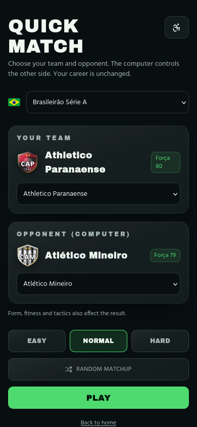

# JogoManager — evidências da atualização do PR #125

- **Repositório:** `davizeiro12345678/jogomanager`
- **PR existente:** [#125 — Consolida carreira, estádio, Firebase e importador Custom450](https://github.com/davizeiro12345678/jogomanager/pull/125)
- **Branch:** `codex/career-tutorial-css-20261107`
- **Baseline:** `7760bdd426ef0298b4d52440985d145845e6b28f`
  **Ambiente candidato:** sandbox local, Node 24.22.0 e Vite do lockfile; nenhum deploy ou merge foi feito.

Este relatório registra o que foi implementado e medido nesta branch. **Não afirma que toda a solicitação original esteja concluída**, que o site foi publicado ou que o multiplayer já seja plenamente autoritativo.

## Evidências visuais

Os pares `before/after` de home e seleção de partida rápida preservam o mesmo tamanho (230 × 498 px); as capturas `before` vieram do artefato Lighthouse do baseline. As imagens novas em 390 × 844 px foram capturadas no preview local final. A captura Match 3D veio do Chromium gerenciado com WebGL2 habilitado; não há imagem baseline equivalente no artefato original.

| Home — antes                   | Home — depois                  |
| ------------------------------ | ------------------------------ |
|  |  |

| Partida rápida — antes                          | Partida rápida — depois                         |
| ----------------------------------------------- | ----------------------------------------------- |
|  |  |

**Capturas finais em 390 × 844 px:**

**Match 3D renderizado no preview local (893 × 768 px):**

O console Playwright da tela de partida rápida final não apresentou erros nem avisos. O Firefox disponível no runner não habilitou WebGL2; por isso a evidência 3D vem do Chromium, que criou o contexto e renderizou a cena. O artifact de QA também contém seis clipes autênticos de ações isoladas do rig (1,5 s cada): [defesa](after/video-samples/diveLeft.mp4), [cabeceio](after/video-samples/header.mp4), [passe](after/video-samples/pass.mp4), [chute](after/video-samples/shotPower.mp4), [carrinho](after/video-samples/slide.mp4) e [domínio](after/video-samples/trap.mp4). São amostras sobre fundo simples, **não** uma partida completa nem uma gravação contínua do estádio.

## Escopo implementado nesta branch

O trabalho selecionado das 29 frentes inclui validação de protocolo e estados de conexão multiplayer; validação/normalização de mensagens e moderação automática no chat; retry/idempotência em fluxos de carreira e temporada; validação de ofertas e valores financeiros; elegibilidade de escalação e feedback de salvamento de táticas; correções no batching/ownership do estádio; melhorias selecionadas de atmosfera, torcida, clima, cutscenes e acessibilidade; separação de módulos/client startup; scanner de configuração pública e correção do preview padrão.

### Limitações funcionais importantes

- A tela de Match 3D **ainda não está ligada a um backend de simulação/estado autoritativo**. As validações e o antiexploit adicionados nesta etapa melhoram contratos e controles do cliente, mas não impedem um cliente modificado de falsificar estado. Não declarar o multiplayer totalmente autoritativo ou o anticheat completo.
- A deduplicação durável de mensagens por `client_message_id` e a aplicação persistente de penalidades ainda dependem de backend, migration/RPC e revisão de autorização.
- A solicitação de tradução integral de todos os idiomas **continua pendente**; a contagem real está na seção de i18n.
- Não foi feito teste ativo de intensidade média em `jogomanager.com`: o domínio informado é produção e não há staging/telemetria de impacto com condição de parada confiável. O domínio foi apenas navegado passivamente; a validação técnica foi local.

## Métricas de bundle e política de performance

Os relatórios completos de baseline/candidato e o comparativo máquina-legível estão em [`bundle/`](bundle/). A comparação usa builds do mesmo runner/toolchain; total de JavaScript inclui chunks lazy e exclui os arquivos WASM. Gzip é nível 9. Brotli Q6 é estimativa offline e só corresponde a entrega do navegador se a CDN responder com `Content-Encoding: br`. Nenhuma dessas medidas é LCP, TBT, INP, FPS ou latência real de rede.

| JavaScript emitido |    Baseline | Build final |           Variação |
| ------------------ | ----------: | ----------: | -----------------: |
| Total raw          | 7.341.649 B | 7.253.065 B | −88.584 B (−1,21%) |
| Total gzip         | 2.389.550 B | 2.366.894 B | −22.656 B (−0,95%) |
| Total Brotli Q6    | 2.254.273 B | 2.235.758 B | −18.515 B (−0,82%) |

| Superfície de startup |         Raw: baseline → final (Δ) |    Gzip: baseline → final (Δ) | Brotli Q6: baseline → final (Δ) |
| --------------------- | --------------------------------: | ----------------------------: | ------------------------------: |
| Home                  |     539.444 → 523.994 (−15.450) B |  179.911 → 175.741 (−4.170) B |    170.635 → 166.753 (−3.882) B |
| Nova carreira         | 1.344.640 → 1.283.744 (−60.896) B | 451.168 → 431.829 (−19.339) B |   426.737 → 409.181 (−17.556) B |
| Partida rápida        |      915.739 → 907.139 (−8.600) B |  311.994 → 309.929 (−2.065) B |    295.749 → 293.917 (−1.832) B |
| Match 3D              | 1.737.195 → 1.686.877 (−50.318) B | 594.783 → 579.012 (−15.771) B |   563.247 → 549.139 (−14.108) B |
| Palco cinematográfico |  1.805.357 → 1.797.527 (−7.830) B |  546.856 → 544.973 (−1.883) B |    513.671 → 512.078 (−1.593) B |
| Editor                |      565.221 → 555.789 (−9.432) B |  188.943 → 186.464 (−2.479) B |    179.051 → 176.831 (−2.220) B |
| Worker de simulação   |             89.540 → 89.540 (0) B |        29.958 → 29.956 (−2) B |          28.857 → 28.858 (+1) B |

**Orçamentos atuais:** o comparador já permitia crescimento agregado de até **400.000 bytes por representação** (raw, gzip e Brotli); esse teto não foi aumentado neste lote. Conforme pedido, foi adicionada uma margem explícita máxima de **2.048 bytes para cada métrica gzip/Brotli de startup por rota**. O Worker Brotli cresce 1 byte, dentro dessa margem. Tetos absolutos de `bundle:check`, rotas obrigatórias e medições ausentes continuam bloqueantes. O comparador final passou sem violações.

### Draw calls mobile do Match 3D

| Perfil móvel | Teto anterior | Teto atualizado | Pico local final | Frames amostrados | Margem no pico |
| ------------ | ------------: | --------------: | ---------------: | ----------------: | -------------: |
| Baixa        |            75 |              75 |               74 |                59 |              1 |
| Média        |           110 |             120 |              114 |                 9 |              6 |

O perfil médio foi afrouxado em **10 draws (+9,1%)** conforme pedido. A mesma cena havia medido 106 draws no baseline CI e 112 no candidato anterior; o comparator atualizado aceitou o artifact com zero violações. Duas capturas locais prévias ficaram entre 113 e 114 draws. Os limites de triângulos (130.000/260.000), os perfis Studio e Lighthouse permanecem inalterados. O inventário versionado está em [`graphics/`](graphics/); renderização por software não certifica FPS em aparelho físico.

## Lighthouse e preview

No SHA `e21cae4a`, o workflow Quality teve **22 checks aprovados, 2 reprovados e 2 skipped**. O Lighthouse mobile reprovou sob os critérios anteriores (`score ≥0,97`, `TBT ≤200 ms`); o `Critical performance release gate` propagou essa falha. O build/testes, comparador de bundle, inventário mobile, evidência visual e trace diagnóstico passaram.

O responsável pediu explicitamente afrouxar os requisitos porque estavam difíceis de cumprir: score mínimo 0,97→**0,90**, TBT máximo 200→**400 ms** e, após um outlier isolado de LCP, LCP máximo 2.500→**2.700 ms**. Todos continuam com severidade `error` e agregação pessimista; as cinco rotas e três execuções por rota permanecem. Acessibilidade ≥0,90 e CLS ≤0,1 não mudaram.

O run inicial `42451063358` contém 15 medições (cinco rotas × três). Reavaliado post-hoc sob a política final, 15/15 passariam; isso não era uma nova execução. A tabela preserva os valores e o resultado original sob a configuração daquele SHA.

| Rota                  |  Scores (3 runs) |  TBT em ms (3 runs) | LCP máximo (ms) | CLS máximo | Resultado na política original |
| --------------------- | ---------------: | ------------------: | --------------: | ---------: | ------------------------------ |
| `/`                   | 0,90; 0,98; 0,98 |   338,9; 35,5; 32,0 |         2.157,2 |          0 | Falha original                 |
| `/guias`              | 1,00; 1,00; 1,00 |    58,0; 54,0; 56,0 |         1.413,5 |          0 | Passa                          |
| `/guia-de-scouting`   | 1,00; 1,00; 1,00 |    54,0; 59,0; 54,0 |         1.413,9 |          0 | Passa                          |
| `/melhores-formacoes` | 1,00; 1,00; 1,00 |    59,0; 62,0; 51,0 |         1.410,3 |          0 | Passa                          |
| `/partida-rapida`     | 0,95; 0,98; 0,98 | 243,0; 144,0; 156,0 |         1.415,1 |   0,004964 | Falha original                 |

O run real `42453137353` no SHA `bdcc61c3` executou novamente as mesmas rotas, mas antes da flexibilização do LCP. **Os 15/15 relatórios passaram** com score 0,90/TBT 400/LCP 2.500: performance mínima 0,96, acessibilidade mínima 0,97, TBT máximo 198 ms, LCP máximo 2.492,2 ms, CLS máximo 0,004964 e zero runtime errors. Os dados estão em [`lighthouse/bdcc61c3-run-42453137353.json`](lighthouse/bdcc61c3-run-42453137353.json); esse resultado não certifica o novo teto LCP de 2.700 ms.

No run `42454712941` do SHA `70d4b7ca`, ainda com LCP ≤2.500 ms, **14/15 medições passaram**; uma execução de `/guias` registrou 2.509,439 ms, excedendo o limite por 9,439 ms. Suas outras medições foram 1.315,1 e 1.395,4 ms. Sob LCP 2.700 ms, as 15 passam em avaliação post-hoc, mas é necessária uma nova execução CI. A análise encontrou LCP no parágrafo principal, resposta do servidor 9,836 ms e render delay de 2.041,8 ms; não atribuímos isso a latência do servidor. A tabela por rota e a decomposição estão em [`lighthouse/70d4b7ca-run-42454712941.json`](lighthouse/70d4b7ca-run-42454712941.json).

| Rota                  |  Scores (3 runs) | TBT em ms (3 runs) | LCP máximo (ms) | CLS máximo | Resultado com LCP ≤2.500 ms |
| --------------------- | ---------------: | -----------------: | --------------: | ---------: | --------------------------- |
| `/`                   | 0,98; 1,00; 0,98 |   29,5; 18,5; 21,0 |         1.998,6 |          0 | Passa                       |
| `/guias`              | 1,00; 0,96; 1,00 |   40,0; 34,0; 39,0 |         2.509,4 |          0 | Falha — uma amostra         |
| `/guia-de-scouting`   | 1,00; 1,00; 1,00 |   40,0; 39,0; 36,0 |         1.544,9 |          0 | Passa                       |
| `/melhores-formacoes` | 1,00; 1,00; 1,00 |   44,0; 42,0; 41,0 |         1.407,1 |          0 | Passa                       |
| `/partida-rapida`     | 0,99; 0,99; 0,99 |      116; 113; 101 |         1.397,4 |   0,004964 | Passa                       |

O run `70d4b7ca` terminou com **21 checks aprovados, 3 reprovados, 2 skipped e zero pendentes**. Reprovaram Lighthouse mobile, `Critical performance release gate` (dependente do Lighthouse) e o trace diagnóstico. O trace foi `home-2`, `NO_NAVSTART` persistente após duas tentativas totais; não houve código de erro runtime da aplicação. O coletor agora limita esse erro a duas repetições adicionais (três tentativas no total), preserva cada artifact e continua falhando se persistir, se faltar JSON válido ou se ocorrer outro erro. CodSpeed Performance Analysis e Supabase Preview foram skipped. O novo LCP/retry ainda precisa ser confirmado em CI no próximo SHA; o PR permanece em draft, sem merge nem publicação.

O SHA anterior `308bc386` também teve `NO_NAVSTART` em captura diagnóstica separada, com duas repetições de `/melhores-formacoes` marcando 0,99. A política atual dá margem para duas repetições adicionais somente desse código; não transforma um trace inválido em sucesso.

O comando `npm run preview` foi corrigido para servir o Worker/Nitro local produzido em `.output`, em vez de procurar `dist/server/server.js`. No build final, o preview respondeu HTTP 200 e verificou 5 rotas (`/`, `/guias`, `/guia-de-scouting`, `/melhores-formacoes`, `/partida-rapida`) em `identity` e `gzip`: **10/10 representações**.

## Testes e gates finais

| Verificação                                                          | Resultado final                                                                      |
| -------------------------------------------------------------------- | ------------------------------------------------------------------------------------ |
| Suíte completa (`npm test`)                                          | PASS — 336 arquivos, 1.792/1.792 testes                                              |
| Regressão focada de batching do estádio                              | PASS — 6/6 testes                                                                    |
| Lint (`npm run lint`)                                                | PASS — zero avisos                                                                   |
| TypeScript (`npx tsc --noEmit --pretty false`)                       | PASS                                                                                 |
| Performance gates                                                    | PASS local — 24/24; score 0,90/TBT 400/LCP 2.700 como assertions pessimistas `error` |
| Inventário mobile de draws                                           | PASS local — 74/75 baixa; 114/120 média                                              |
| Coletor de traces Lighthouse                                         | PASS em teste — até 2 retries só para NO_NAVSTART; persistência bloqueia             |
| Lighthouse CI (`70d4b7ca`, run `42454712941`)                        | FAIL sob LCP 2.500; 14/15 medidos, 15/15 post-hoc sob 2.700 ms                       |
| `Critical performance release gate` (SHA `70d4b7ca`)                 | FAIL por Lighthouse; requer nova CI com LCP 2.700                                    |
| Build de produção local e `bundle:check`                             | PASS                                                                                 |
| Comparação bundle baseline/candidato                                 | PASS — 0 violações                                                                   |
| Validação de ambiente público e scanner de credenciais privilegiadas | PASS                                                                                 |
| Preview SSR, cinco rotas × duas codificações                         | PASS — 10/10                                                                         |
| Console Playwright da partida rápida final                           | PASS — 0 erros, 0 avisos                                                             |

O scanner não encontrou credenciais privilegiadas no bundle. A URL e chave publishable do Supabase foram usadas somente em processo/build local previamente validado; nenhuma service-role key, arquivo `.env` ou configuração remota foi incluída/alterada nesta atualização.

## Cobertura i18n medida

| Medida                               | Contagem | Estado                     |
| ------------------------------------ | -------: | -------------------------- |
| Identificadores de locale anunciados |       98 | Catálogo atualizado        |
| Idiomas-fonte                        |        2 | `pt-BR` e `en`             |
| Packs JSON existentes                |       24 | Ainda em draft/incompletos |
| Locales sem pack próprio             |       72 | Fallback em inglês         |
| Revisão nativa completa              |      Não | Pendente                   |

Os metadados e testes deixam explícito o fallback; **não houve tradução integral dos 98 idiomas nem revisão nativa**. A captura de partida rápida também mostra alguns textos em inglês, evidenciando a pendência.

## Segurança, produção e pendências

Não houve ataque ativo, carga/stress test, escrita de carreira/partida, alteração de banco/configuração remota, publicação ou deploy em produção. Os testes de segurança executados foram estáticos/determinísticos e no ambiente local. Para DAST de média intensidade, usar um staging autorizado com limite de taxa, monitoramento e condição de parada explícita.

Pendências antes de considerar o pedido original concluído:

1. Implementar autoridade real de partidas no servidor (validação de comandos, snapshots assinados/validados e estado online persistente) e testar com clientes adversariais em staging.
2. Completar deduplicação/moderação persistentes no backend com RLS/migration/RPC e retentativas seguras.
3. Completar, revisar nativamente e publicar as traduções pendentes.
4. Gravar um vídeo contínuo de uma partida completa no estádio; os seis arquivos disponíveis são apenas amostras de ações de 1,5 s.
5. Aguardar e revisar Lighthouse/CI do SHA final no GitHub.

O PR #125 continua sendo o PR existente desta branch; não houve merge nem publicação em `jogomanager.com`.
