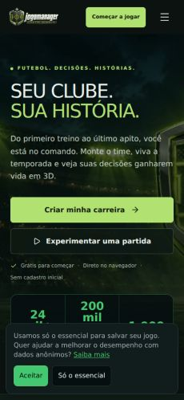
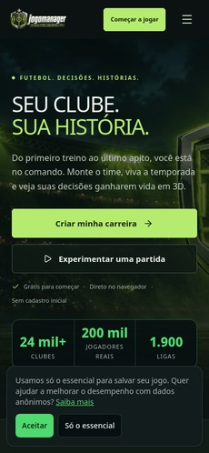
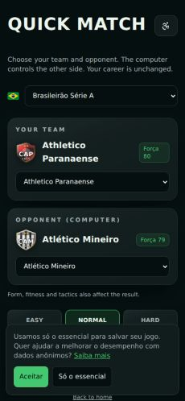
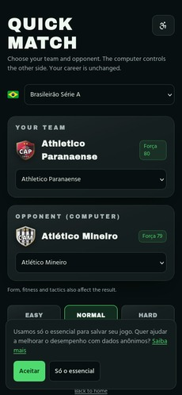
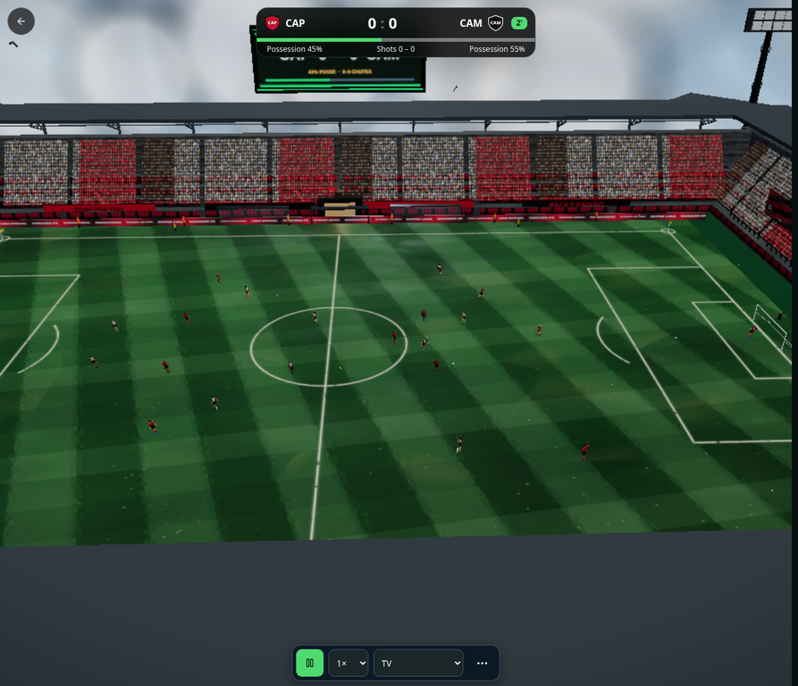

# JogoManager — evidências da atualização do PR #125

**Repositório:** `davizeiro12345678/jogomanager`
**PR:** [#125 — Consolida carreira, estádio, Firebase e importador Custom450](https://github.com/davizeiro12345678/jogomanager/pull/125)
**Branch:** `codex/career-tutorial-css-20261107`
**Baseline analisado:** `7760bdd426ef0298b4d52440985d145845e6b28f`
**Escopo deste relatório:** build local candidato e evidências da sessão. Não é uma afirmação de que toda a lista original foi concluída nem de que a versão foi publicada em produção.

## Capturas antes/depois

As capturas `before` foram extraídas do artefato Lighthouse do baseline; as de `after` são do preview da branch. As duas comparações abaixo têm o mesmo tamanho (230 × 498 px). As originais móveis de 390 × 844 px também estão preservadas. A captura do Match 3D é uma evidência posterior, sem imagem baseline equivalente no artefato original.

| Página inicial — antes | Página inicial — depois |
|---|---|
|  |  |

| Seleção de partida rápida — antes | Seleção de partida rápida — depois |
|---|---|
|  |  |

**Match 3D no Chromium gerenciado (preview local, 893 × 768 px):**

O Chromium gerenciado aceitou WebGL2 e mostrou o estádio/campo/jogadores. O Firefox usado pelo Playwright não permite WebGL2 no runner (`AllowWebgl2:false`), portanto seus erros de criação de contexto não foram atribuídos ao jogo. A captura do match é uma imagem real da branch, não uma imagem gerada. Não havia ferramenta de gravação contínua de browser disponível; por isso nenhum vídeo de gameplay foi fabricado ou apresentado como gravação completa.

## Escopo integrado nesta branch

As alterações selecionadas do workflow de 29 frentes abrangem: validação de protocolo e estados de conexão multiplayer; validação/normalização de mensagens e moderação automática no chat; retry e idempotência em fluxos de carreira/temporada; previsão financeira e validação de ofertas; elegibilidade de escalação e feedback de salvamento de táticas; melhorias no batching/ownership do estádio, atmosfera, reações da torcida, clima e transições de cutscene; ajustes de interface e acessibilidade; metadados de cobertura i18n; scanner de configuração pública e correção do comando de preview padrão.

**Limite importante:** isto melhora controles e contratos do cliente, mas não transforma `/match` em multiplayer totalmente autoritativo. A tela ainda não está conectada a um endpoint operacional de simulação/estado autoritativo; durabilidade de deduplicação de chat por `client_message_id` também requer trabalho de backend/migration/RPC. Não afirmar o multiplayer como concluído.

## Métricas de bundle

Medição feita pelo `scripts/bundle-report.mjs` em builds da mesma branch/base. O total soma **todos** os chunks JS emitidos, incluindo chunks lazy; não equivale ao download inicial de uma rota. Gzip é nível 9 e Brotli Q6 é estimativa offline.

| Métrica | Baseline | Build atual | Variação |
|---|---:|---:|---:|
| JS emitido total — raw | 7.252.912 B | 7.255.709 B | +2.797 B (+0,039%) |
| JS emitido total — gzip | 2.359.628 B | 2.361.267 B | +1.639 B (+0,070%) |
| JS emitido total — Brotli Q6 | 2.228.070 B | 2.229.943 B | +1.873 B (+0,084%) |
| Chunk `hydrate-app` — raw | 379.661 B | 326.457 B | −53.204 B (−14,01%) |
| Chunk `hydrate-app` — gzip | 118.488 B | 100.544 B | −17.944 B (−15,14%) |
| Chunk `hydrate-app` — Brotli Q6 | 111.374 B | 94.061 B | −17.313 B (−15,54%) |
| Chunk `Stadium3D` — raw | 194.235 B | 194.515 B | +280 B |
| Chunk `Stadium3D` — gzip | 64.649 B | 64.723 B | +74 B |
| Chunk `Stadium3D` — Brotli Q6 | 60.223 B | 60.292 B | +69 B |

| Startup estático da rota | Baseline raw / gzip / Brotli | Atual raw / gzip / Brotli | Variação Brotli |
|---|---:|---:|---:|
| Home | 502.676 / 164.335 / 155.479 B | 503.237 / 165.443 / 156.664 B | +1.185 B (+0,76%) |
| Seleção de partida rápida | 911.034 / 308.340 / 291.907 B | 911.594 / 309.441 / 293.104 B | +1.197 B (+0,41%) |
| Match 3D | 1.690.608 / 574.891 / 544.494 B | 1.691.612 / 576.096 / 545.799 B | +1.305 B (+0,24%) |

O comparador já presente no baseline do PR permite crescimento agregado máximo de **400.000 bytes** em raw, gzip e Brotli, usando cada total como seu próprio limite. Este lote não elevou esse limite; adiciona testes de regressão que confirmam a margem existente. O build atual consome 0,70% dela no total raw. Os orçamentos absolutos e as restrições de crescimento do startup Brotli/gzip por rota continuam ativos. O teste de performance mantém score Lighthouse mínimo 0,97, LCP máximo 2.500 ms, CLS máximo 0,1 e TBT máximo 200 ms, com agregação pessimista.

## Lighthouse e validação do preview

O baseline de CI `42429874392` mediu três execuções móveis por rota. `/` teve performance [0,95; 0,98; 0,98], TBT [195; 27,5; 41] ms, LCP de aproximadamente 2.002–2.040 ms e CLS 0. `/partida-rapida` teve performance [0,96; 0,98; 0,98], TBT [201; 157; 145] ms, LCP de aproximadamente 1.408–1.567 ms e CLS ~0,00496. Esses resultados explicam a falha do baseline no pior caso. A medição Lighthouse **depois** ainda depende do workflow do GitHub após o push desta branch; não foi inventada nem estimada a partir de screenshot.

O comando `npm run preview` antigo caía em HTTP 500 por chamar `vite preview` e procurar `dist/server/server.js`, enquanto o build produz um Worker/Nitro em `.output`. O alias passou a usar `preview:worker`; o teste de regressão confirma essa representação. O preview local configurado passou cinco rotas (`/`, `/guias`, `/guia-de-scouting`, `/melhores-formacoes`, `/partida-rapida`) em `identity` e `gzip` (10 representações verificadas). O scanner de bundle não encontrou valores de credenciais privilegiadas.

A URL e a chave publishable do único projeto Supabase identificado como JogoManager foram usados apenas no processo/build local para validar a interface. Nenhuma service-role key foi usada, nenhum valor de ambiente foi adicionado ao Git e nenhuma configuração remota foi alterada. O fluxo de partida rápida é local; a consulta opcional de catálogo foi isolada com cache local recente para evitar paginação extensa no projeto de produção.

## Testes executados

| Gate | Resultado |
|---|---|
| Suíte completa | PASS — 1.785 testes em 335 arquivos |
| Testes focados dos módulos modificados | PASS — 98 testes em 14 arquivos |
| Lint (`npm run lint`, zero avisos) | PASS |
| Performance/bundle gates | PASS — 23/23 |
| Teste Node do preview | PASS — 3/3 |
| `npm run build` + `bundle:check` | PASS |
| Scanner de ambiente/bundle público | PASS |
| Preview SSR, 5 rotas × identity/gzip | PASS — 10/10 |
| TypeScript (`npx tsc --noEmit`) | BLOQUEADO por 2 erros preexistentes em `src/lib/stripe.server.ts`: pin `
`2026-09-30.endive` incompatível com o tipo atual do SDK (`2026-10-28.endive`). O arquivo Stripe não foi alterado para evitar uma mudança de versão de API financeira dentro deste lote.

## Cobertura i18n medida

| Medida | Contagem | Situação |
|---|---:|---|
| Identificadores de locale anunciados | 98 | Catálogo atualizado |
| Idiomas-fonte | 2 | `pt-BR` e `en` |
| Packs JSON existentes | 24 | Ainda `draft`/não completos |
| Locales sem pack que usam fallback inglês | 72 | Não traduzidos integralmente |

A paridade e o fallback ficaram explícitos nos metadados/testes, mas **a tradução completa das 98 línguas não foi concluída** e os packs existentes não passaram por revisão nativa.

## Segurança, pen-test e produção

As alterações incluem verificações locais de protocolo, identidade/payload, controles anti-evasão de texto, moderação e penalidade automática, além do scanner que impede publicar credenciais privilegiadas no bundle. Os testes executados foram locais e determinísticos.

**Não foi executado ataque de média intensidade em `jogomanager.com`.** O domínio é produção e não havia ambiente de staging nem telemetria de impacto/stop condition confiável para esse teste; o site foi apenas navegado passivamente. Não houve deploy, alteração de banco/configuração remota, stress test nem escrita de partida/carreira em produção.

## Pendências explícitas

1. Conectar a tela Match 3D a um backend de multiplayer verdadeiramente autoritativo (snapshot/command validation no servidor), em vez de declarar completo o protocolo cliente atual.
2. Tornar deduplicação de chat durável no backend e rever o modelo de penalidades com migrations/RPC apropriados.
3. Completar e revisar nativamente os 72 fallbacks e os packs `draft`.
4. Aguardar e analisar o Lighthouse/CIs do SHA após o push; a imagem e o bundle local não substituem essa medição.
5. Gravar uma partida completa somente quando houver ferramenta de captura contínua disponível. Este relatório contém screenshots verificáveis, não vídeo.

O PR #125 permanece existente e em draft; este lote não fez merge nem publicação no domínio público.
